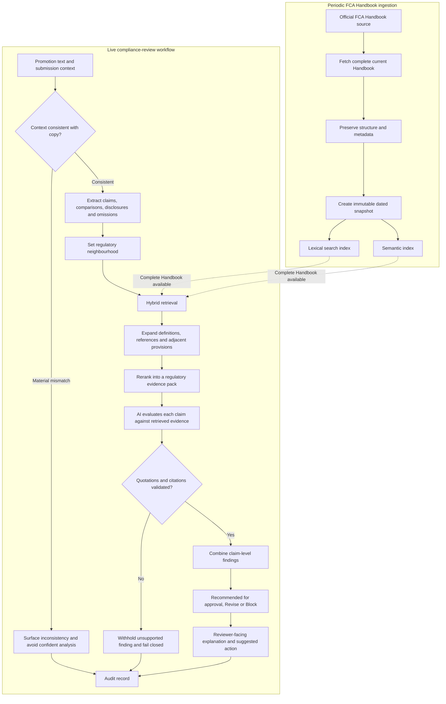
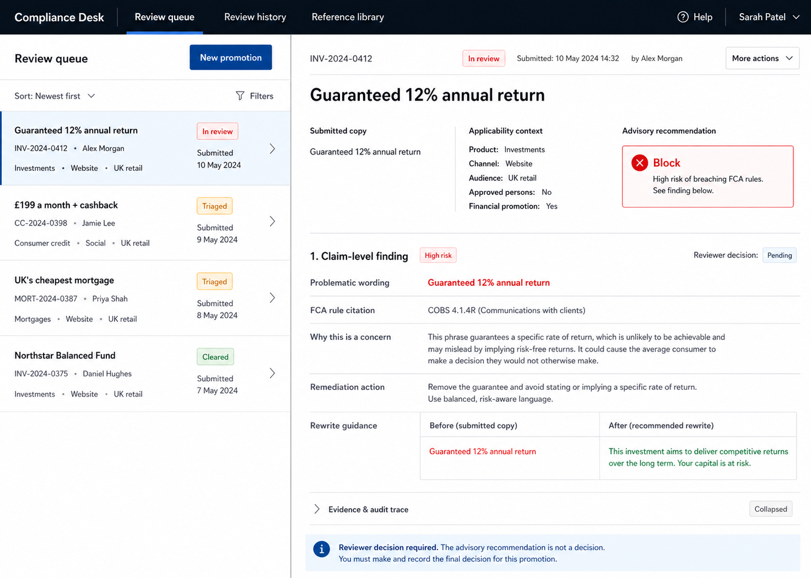

# Zango FinProm AI Workflow — Working Project Brief

**Status:** Working prototype implemented; hosted verification in progress  
**Last updated:** 30 August 2026  
**Purpose of this document:** This is the source of truth for the project. It records agreed decisions, current assumptions and unresolved questions. It should be updated as decisions are made, before implementation changes begin.

## 1. Project goal

Build a focused, credible demonstration of an AI-assisted financial-promotion compliance workflow for Zango.

The objective is to show that the candidate can:

- Understand the compliance reviewer's workflow.
- Translate regulatory requirements into a usable product.
- Design a grounded, auditable AI workflow.
- Make sensible scope and production trade-offs.
- Explain how the prototype could evolve into a production capability.

This is a work sample, not an attempt to build a complete enterprise compliance platform.

## 2. Primary user and workflow

### Primary customer

The primary customer is a **compliance reviewer** responsible for assessing a financial promotion before publication.

### Upstream user

A marketing or product employee drafts the promotion and submits it for review. The submission includes both the promotional copy and its business context.

### Product role

The product is a **decision-support copilot**. It analyses the submission, identifies potential issues and gives the compliance reviewer evidence for their decision.

It does not autonomously approve a promotion or replace reviewer accountability.

## 3. Demonstration scope

### Included

- United Kingdom only.
- FCA regulatory material.
- Text-based financial promotions.
- Retail customers as the default audience.
- Three product paths:
  - Investments
  - Consumer credit
  - Mortgages
- Three or four prepared sample promotions.
- Free-text promotion input.
- Claim-level findings with FCA citations.
- Suggested rewrites.
- An auditable AI workflow.

### Explicitly excluded

- EU or other international regulatory regimes.
- Image, audio and video analysis.
- Autonomous regulatory approval.
- Comprehensive production integrations.
- A claim that every possible FCA-regulated product and scenario is fully supported.

The production retrieval design assumes the full FCA Handbook is available to the retrieval system, while the demonstrated and evaluated product journeys remain deliberately limited to the three product paths above. The public work-sample deployment uses a small, clearly labelled regulatory pack until authenticated FCA API access and the necessary Handbook-content permission or licence are in place.

## 4. Submission input

The demo interface will contain:

1. Three or four sample-phrase buttons.
2. A free-text box for arbitrary promotional copy.
3. A product selector with three options:
   - Investments
   - Consumer credit
   - Mortgages
4. A channel selector, initially covering:
   - Website
   - Social media
   - Email
5. Retail customer as the default audience.
6. United Kingdom / FCA Handbook as fixed jurisdictional context.
7. A fixed demo assumption that the firm is communicating its own promotion.

Selecting a prepared sample will populate both the promotional copy and its submission context. The user can edit the loaded copy before requesting a review.

For free text, the user selects the product and channel. The compliance system should not silently invent material applicability facts.

### Supporting-evidence boundary

The demo will not include a separate field for uploading studies, datasets, calculations or supporting URLs.

The FCA expectation that promotions are standalone compliant means each promotion must comply when considered individually, including presenting the consumer-facing information, balance and warnings required for that communication. It does not generally mean that the promotion must reproduce all of the firm's underlying substantiation material. Supporting information may be layered or linked where appropriate, while the initial promotion must remain compliant in its own right.

The FCA also expects an approving firm to consider the substance and veracity of claims and whether they can be substantiated. That due diligence may rely on material held outside the promotion, such as financial statements, management accounts, calculations or business plans.

Accordingly, this prototype will:

- Assess the submitted promotion and its context.
- Identify consumer-facing information or warnings that are missing from the promotion.
- Identify factual or comparative claims that require the reviewer to verify underlying substantiation.
- Avoid asserting that external evidence does or does not exist when it was not supplied to the system.

**Primary sources:**

- https://www.fca.org.uk/publication/finalised-guidance/fg24-1.pdf
- https://www.fca.org.uk/publication/policy/ps22-10.pdf

## 5. Prepared demonstration cases

The prepared examples are synthetic promotions informed by FCA rules and published examples. They are not copied advertisements. Together they test four different behaviours: explicit misleading language, missing required information, an unsubstantiated comparison and a clean baseline.

### Example 1 — Guaranteed investment return

**Button label:** Guaranteed return  
**Promotion:** “Earn a guaranteed 12% annual return with our investment bond. Your capital is completely secure.”  
**Product:** Investments  
**Channel:** Website  
**Audience:** UK retail customers  
**Expected recommendation:** Block

**Why this case is useful:** It tests whether the system can assess the meaning and context of “guaranteed” and “secure”, retrieve the investment-specific rules and distinguish a serious misleading claim from a minor wording issue. COBS 4.2.5G says these descriptions should not be used unless they can be made fair, clear and not misleading with the necessary information and prominence. The FCA has also identified attractive investment-return claims that firms could not substantiate as a recurring problem.

**Primary sources:**

- https://handbook.fca.org.uk/handbook/cobs4/cobs4s2
- https://www.fca.org.uk/about/case-study/raise-standards-new-firms-promotions

### Example 2 — Car-finance payment and incentive

**Button label:** £199 car finance  
**Promotion:** “Drive away today for only £199 a month — plus £500 cashback when you apply online.”  
**Product:** Consumer credit  
**Channel:** Social media  
**Audience:** UK retail customers  
**Expected recommendation:** Revise

**Why this case is useful:** The wording is not intrinsically false. The problem is what the promotion omits and how prominently required information must appear. It tests whether the system can recognise that a monthly payment and an incentive can trigger representative-example and representative-APR requirements. This is based directly on common car-finance mistakes identified in the FCA’s financial-promotion case studies.

**Primary sources:**

- https://www.fca.org.uk/firms/financial-promotions-adverts/case-studies
- https://handbook.fca.org.uk/handbook/conc3

### Example 3 — Mortgage comparison requiring evidence

**Button label:** Cheapest mortgage  
**Promotion:** “Switch to the UK’s cheapest mortgage and save £250 every month.”  
**Product:** Mortgages  
**Channel:** Website  
**Audience:** UK retail customers  
**Expected recommendation:** Block

**Why this case is useful:** It tests two forms of substantiation: the basis for an absolute market comparison and the evidence behind a quantified monthly saving. It also tests whether the system notices missing mortgage-specific balance and risk information rather than evaluating the sentence only as generic advertising copy. MCOB 3A requires comparisons to be meaningful, fair and balanced, and requires relevant risks and the secured nature of the credit to be communicated where applicable.

**Primary source:**

- https://handbook.fca.org.uk/handbook/mcob3a/mcob3as3

### Example 4 — Balanced baseline

**Button label:** Balanced investment  
**Promotion:** “Explore the Northstar Balanced Fund. The value of investments can fall as well as rise, and you may get back less than you invest. View the fund details and charges.”  
**Product:** Investments  
**Channel:** Website  
**Audience:** UK retail customers  
**Expected recommendation:** Recommended for approval

**Why this case is useful:** The demo needs a negative control so that it does not appear to flag every promotion. This example makes no quantified return claim and presents downside risk alongside the invitation. `Recommended for approval` means only that no material issue was identified in the submitted text and context; the reviewer still makes the decision.

**Primary sources:**

- https://handbook.fca.org.uk/handbook/cobs4/cobs4s2
- https://www.fca.org.uk/consumers/misleading-financial-promotions

### Design note

The expected recommendations form the initial acceptance baseline, not hard-coded application behaviour. The implemented workflow must reach them through applicability, retrieval and grounded analysis. Evaluation should also include paraphrases and adversarial variants so success cannot be achieved by recognising the four prepared sentences.

## 6. Review output

The system returns one of three advisory recommendations:

- **Recommended for approval** — no material issue was identified from the supplied copy and context, subject to any stated reviewer verification.
- **Revise** — the promotion contains an issue that may be resolved through changes or additional information.
- **Block** — the identified issue is sufficiently serious that the promotion should not proceed in its current form.

Every recommendation requires a compliance reviewer's confirmation. `Recommended for approval` does not mean that the system has approved the promotion.

There will not be a separate `Human review required` recommendation because human review is part of every outcome.

### Recommendation-specific content

The result should change meaningfully according to the recommendation rather than displaying the same generic content under a different status.

#### Recommended for approval

- Identify the principal rules considered applicable.
- Explain briefly how the submitted wording appears to satisfy those rules.
- State the scope and assumptions of the review.
- Avoid suggesting that the system has formally approved the promotion.

#### Revise

- Identify each issue and its supporting rule or guidance.
- Explain why the issue requires amendment or further substantiation.
- Give a specific action for the submitter.
- Tell the reviewer what underlying substantiation should be verified for factual or comparative claims.
- Offer a suggested safer rewrite where wording can resolve the problem.

For example, a quantified claim may require the reviewer to verify a supporting study, calculation methodology, underlying dataset or comparison basis. That material remains outside the demo rather than being submitted through a separate evidence field.

#### Block

- Identify the materially problematic wording.
- Cite the applicable rules or guidance.
- Explain why the current promotion conflicts with those requirements.
- State what must change before the promotion can be reconsidered.
- Provide a suggested safer formulation where a rewrite is possible.
- Make clear when the issue cannot be resolved through wording alone and requires product evidence or a change to the underlying proposition.

For each identified issue, the result should show:

- The exact promotional wording being assessed.
- The applicable FCA rule or guidance.
- A direct source citation.
- A plain-language explanation of the concern.
- Whether the problem concerns wording, balance, prominence, omission or substantiation.
- Any missing consumer-facing disclosure and any claim requiring reviewer substantiation.
- A suggested compliant rewrite where appropriate.
- The assumptions used during the review.

The prototype should not include an `Approve` button.

### Result presentation

- Display the positive outcome as **Recommended for approval**. This describes the system's recommendation without implying that it exercised the reviewer's approval authority.
- Show a short applicability summary: product, audience, channel, jurisdiction and principal sourcebooks considered.
- Show a substantiation status for each factual claim as `Reviewer to verify` or `Not required`. Separately show whether required consumer-facing information is `Present` or `Missing`. Do not present an opaque model-confidence percentage.
- Present the original and suggested wording as a compact before/after comparison.
- Keep the detailed retrieval and audit trace available in a collapsed section so the normal review screen remains readable.

## 7. Agreed architecture direction

The prototype will use a staged, controlled AI workflow rather than a single prompt, a regex checker or an unconstrained autonomous agent.

The intended stages are:

1. Receive promotion and submission context.
2. Determine the applicable regulatory neighbourhood.
3. Extract individual claims, disclosures and potential omissions.
4. Retrieve relevant FCA material from the full indexed Handbook.
5. Evaluate each claim against the retrieved material.
6. Validate quotations, citations and grounding.
7. Produce the advisory recommendation and audit record.

### Regulatory source principles

- The FCA Handbook is the regulatory source of truth, not the model's training data.
- The complete current Handbook should be ingested and searchable.
- Retrieval should narrow the full corpus using product and submission context.
- Source text, rule identifiers, URLs and effective-version information should be preserved.
- Dated Handbook snapshots will be needed for reproducible historic review records because the FCA API supplies current material rather than historic versions.

### Model principles

- Use the OpenAI API as the hosted model provider for the prototype, behind a small provider-neutral interface.
- Keep the exact OpenAI model configurable rather than treating it as a product-level architecture decision. Select the initial model during implementation using the agreed evaluation cases, structured-output reliability and interactive latency.
- A local Ollama model is not a requirement for the demonstration.
- The model may reason over retrieved evidence but may not invent rules or citations.
- The workflow must be able to abstain from a particular finding when the evidence is insufficient, without turning abstention into a separate overall recommendation category.
- Use deterministic application checks—not the model—to verify quoted promotion text, retrieved rule identifiers and regulatory quotations.

### Implemented prototype workflow

The working prototype uses two constrained model calls and one retrieval step:

1. `openai/gpt-5.6-luna-fast` extracts claims, disclosures, omissions and context signals into a validated schema.
2. Lexical ranking and `openai/text-embedding-3-small` semantic similarity are fused to produce the evidence pack.
3. `openai/gpt-5.6-terra-fast` evaluates the claims only against that evidence pack and returns a second validated schema.
4. Application code—not the model—checks quoted promotional text, resolves FCA rule identifiers to stored exact quotations, derives the overall recommendation and creates the audit record.

The model identifiers are configuration rather than permanent product choices. The deployment uses Vercel AI Gateway and its deployment identity; a local deterministic fixture exists only for UI development and automated tests when hosted model credentials are unavailable.

## 8. Auditability and safeguards

Each review should retain enough information to explain how the result was produced, including:

- Submitted promotion and context.
- Extracted claims.
- Retrieved FCA provisions.
- Source and Handbook version metadata.
- Findings and supporting quotations.
- Model and prompt/workflow version.
- Validation results.
- Final advisory recommendation.

Safeguards should include:

- Every citation must refer to retrieved source material.
- Every regulatory quotation must exist in the cited source.
- Every quoted promotion fragment must exist in the submitted copy.
- Suggested rewrites must not introduce unsupported product facts.
- Claims requiring external substantiation must be surfaced to the reviewer without implying that the evidence is absent merely because it was not submitted to the prototype.

## 9. Evaluation plan

The prototype should be evaluated with a compact set of 12 cases. The objective is to demonstrate grounded workflow behaviour, not to claim production-grade regulatory coverage.

### Test set

#### Group A — Four showcase cases

Run the four prepared examples exactly as displayed in the interface. All four must return their agreed recommendation and principal regulatory finding.

#### Group B — Four paraphrase cases

Rewrite each prepared example without changing its regulatory meaning. These cases test whether the workflow reasons about claims and omissions rather than matching memorised words or prepared sentences.

Examples include:

- Replacing “guaranteed” with an equivalent claim such as “your return is assured”.
- Rephrasing the car-finance payment and cashback offer while continuing to omit the representative information.
- Rephrasing the absolute mortgage comparison and quantified saving.
- Rewording the balanced investment example without introducing a new claim.

#### Group C — Four boundary cases

Use near-neighbour examples where a small change should alter the analysis:

- An investment promotion describing a target return rather than a guaranteed return, with clear downside risk.
- A car-finance promotion that includes the triggered representative example and representative APR information.
- A mortgage comparison that states its comparison basis and includes the relevant risk information, while leaving external substantiation for reviewer verification.
- A deliberate mismatch between the selected product metadata and the promotional copy. The system should surface the inconsistency rather than retrieve and apply an irrelevant sourcebook confidently.

### Non-negotiable acceptance gates

- All four showcase cases reach the agreed recommendation.
- Every cited rule exists in the retrieved FCA material.
- Every regulatory quotation is an exact extract from its cited source.
- Every highlighted promotional phrase exists in the submitted copy.
- The correct principal sourcebook is selected, or the deliberate context mismatch is surfaced, for all 12 cases.
- No materially misleading or disclosure-deficient case receives `Recommended for approval`.
- The system never claims that external substantiation is present or absent when it was not provided.
- Suggested rewrites do not invent product features, figures or evidence.
- If retrieval or citation validation fails, the workflow fails closed rather than generating an ungrounded regulatory conclusion.

### Quality targets

- At least seven of the eight paraphrase and boundary cases reach the expected recommendation and principal finding.
- All results follow the agreed structured result format.
- All results contain the applicability summary and reviewer-facing rationale.
- Typical demo response time should be recorded and kept short enough for an interactive review; 15 seconds is the initial target rather than a production service-level commitment.

### Manual review rubric

Each case will be scored against five questions:

1. Did it identify the correct regulatory context?
2. Did it retrieve and cite the correct FCA material?
3. Did it identify the material claim, omission or substantiation check?
4. Was the recommendation defensible from the supplied copy and context?
5. Was the explanation and suggested action useful to a compliance reviewer?

Visual prominence is outside the text-only prototype's verification capability. The system may identify that prominence is required, but it must not claim that layout, font size, placement or visual balance has been verified.

## 10. Retrieval architecture

### Recommendation

Use a **hybrid retrieval pipeline over a versioned private copy of the complete current FCA Handbook**. Product context narrows the search, but does not reduce the indexed corpus to a few hand-picked rules.

The full snapshot should not be bundled into a Vercel Function or shipped to the browser. The intended production layout is: authenticated FCA API ingestion, immutable raw snapshots in private object storage, and a co-located Postgres lexical/vector index queried by a lean London-region review function. This keeps the review path fast while preserving versioning and auditability.

This is preferable to the main alternatives:

| Approach | Strength | Limitation | Decision |
| --- | --- | --- | --- |
| Put Handbook text directly into one large model prompt | Fast to prototype | Weak traceability, context limits and poor retrieval control | Reject |
| Keyword search only | Good for exact rule names and phrases | Misses rules expressed in different language | Insufficient alone |
| Vector search only | Good semantic recall | Can return conceptually similar but legally inapplicable material | Insufficient alone |
| Hybrid lexical and semantic search with metadata filters | Combines exact regulatory language, semantic recall and applicability control | Requires a small ingestion and ranking pipeline | Recommended |

### Ingestion and regulatory store

1. Fetch the complete current Handbook through an authenticated, permitted official FCA source.
2. Store an immutable dated snapshot so a review can be reproduced against the same regulatory version.
3. Preserve the Handbook hierarchy rather than treating it as an undifferentiated text dump: sourcebook, chapter, section, provision identifier, provision type, heading, text, effective/version metadata, URL and cross-references.
4. Split the material at provision or small subsection level, retaining enough neighbouring text to make each provision intelligible.
5. Create both a lexical index and semantic embeddings for the same provisions.

The live review workflow should query the private indexed snapshot, not depend on the FCA API responding during a review. Refreshing the snapshot is a separate ingestion operation.

For the public work sample, the same retrieval interface is backed by a selected eight-provision pack covering the three evaluated product paths. This is an explicit deployment constraint, not a claim that the demo has comprehensive regulatory coverage: the FCA's current Handbook terms restrict large-scale storage and electronic retrieval of Handbook content without permission, while the FCA Handbook API requires registration and authenticated access.

### Runtime retrieval flow

1. **Validate context:** check the selected product, channel, audience and jurisdiction against the submitted copy. Surface a likely product mismatch rather than silently trusting inconsistent metadata.
2. **Set the regulatory neighbourhood:** use the product selection to prioritise the principal sourcebook—COBS for investments, CONC for consumer credit and MCOB for mortgages—while retaining access to cross-cutting Handbook material.
3. **Extract search concepts:** identify claims, omissions, comparisons, incentives, warnings and relevant regulatory concepts from the promotion.
4. **Run hybrid search:** combine exact-term search and semantic retrieval, filtered and boosted by the applicability context.
5. **Expand important references:** retrieve definitions, linked provisions and adjacent text needed to interpret the strongest candidate rules.
6. **Rerank into an evidence pack:** select a small set of the most relevant provisions for claim-level evaluation. The evaluator receives this evidence pack rather than unrestricted Handbook text.
7. **Validate grounding:** confirm that every cited provision and quotation exists in the retrieved snapshot. A finding without validated regulatory support is withheld.

### Why this is the right prototype boundary

- The production design indexes the **whole Handbook**, demonstrating a real regulatory retrieval workflow without placing licensed regulatory content in the browser or function bundle.
- The three selected products provide strong applicability signals and make the demo testable.
- Retrieval and reasoning remain separate, so the audit trail can show which rules informed each conclusion.
- The architecture can later add firm policies, previous decisions and more jurisdictions without changing the reviewer-facing workflow.
- It avoids building unnecessary production infrastructure before the core workflow is proven.

### Prototype deliverables for this layer

- A specified authenticated Handbook ingestion boundary, to be activated when FCA access and content permission are available.
- One dated, searchable private FCA snapshot with source metadata in the production design; the public demo substitutes a versioned selected pack.
- A retrieval function that accepts the promotion and agreed context and returns a ranked evidence pack.
- A simple inspection view or saved trace showing the query concepts, retrieved provisions, ranking and source links.
- Retrieval tests covering the 12 agreed evaluation cases before recommendation generation is added.

### Architecture flow

## 11. Visual design direction

The prototype will use a desktop, split-pane compliance-review workspace:

- A dark application header with `Review queue` as the active tab and inactive `Review history` and `Reference library` tabs to communicate the wider product model.
- A left-hand queue containing the four prepared examples as realistic internal review tickets.
- A prominent `New promotion` action that creates a new ticket from free-text copy and its submission context.
- A right-hand case workspace showing the selected ticket, applicability context, advisory recommendation, claim-level findings, FCA citations, remediation and suggested wording.
- A collapsed evidence and audit trace so the primary screen stays readable.
- Restrained, professional compliance styling with semantic outcome colours used sparingly.

The history and reference-library tabs may remain inactive in the prototype. They are present to show how the demonstrated workflow fits into a broader company product.

**Selected visual reference:** `design/references/finprom-review-queue-v1.png`

## 12. Open decisions and external dependencies

The following items remain after the working prototype:

1. Obtain an FCA Handbook API account and confirm the licence or written permission required to store and index the complete Handbook for a public or private electronic retrieval system.
2. Select the production data services for immutable snapshots and the co-located Postgres full-text/vector index.
3. Tune hybrid retrieval and model selection against a larger, expert-labelled evaluation set; the current reciprocal-rank fusion and fast-model choices are prototype defaults.
4. Decide what the presentation deck should demonstrate beyond the working prototype.

## 13. Decision log

### 30 August 2026

- Implemented the working review-queue prototype with the agreed three outcomes, four stored tickets, arbitrary free-text submissions, submission context, claim-level evidence, remediation, audit trace and reviewer-decision boundary.
- Implemented a two-call OpenAI workflow through Vercel AI Gateway: structured claim extraction, hybrid retrieval and evidence-grounded evaluation, followed by deterministic citation and quotation validation.
- Fixed the prototype model defaults to Luna Fast for extraction, `text-embedding-3-small` for semantic retrieval and Terra Fast for evaluation, while keeping every identifier configurable.
- Implemented all 12 agreed exact, paraphrase and boundary evaluations; the deterministic development fixture passes the complete set and hosted-model verification remains the deployment gate.
- Added a fail-closed regression gate after the phrase `Unlimited loan amount instantly` exposed an unsafe fall-through: absence of a matched issue can never produce a positive recommendation. Positive recommendations now require every extracted claim to be covered by an explicit `meets` finding and no unresolved omission topics.
- Recorded the FCA-content constraint: the hosted public demo uses a selected versioned regulatory pack. Full-Handbook production ingestion requires authenticated FCA API access and content permission/licensing, and will store the corpus outside the Vercel function bundle in private object storage plus a co-located Postgres hybrid index.
- Confirmed the 12-case evaluation plan: four showcase cases, four paraphrases and four boundary cases, with grounding and fail-closed acceptance gates.
- Confirmed hybrid lexical and semantic retrieval over a versioned local snapshot of the complete current FCA Handbook as the overall retrieval architecture.
- Deferred the detailed comparison and implementation of lexical and semantic indexing until later; the architecture does not yet lock in a search engine, embedding model, fusion method or ranking thresholds.
- Selected the OpenAI API as the prototype model provider. The exact model remains a configurable implementation choice to be checked against the evaluation set rather than a core product dependency.
- Selected the split-pane review queue as the prototype's visual direction, with the prepared examples represented as existing tickets and `New promotion` creating a new submission.
- Added inactive `Review history` and `Reference library` tabs to communicate how the workflow would sit inside a broader compliance product.
- Preserved the selected reference image at `design/references/finprom-review-queue-v1.png` for future implementation and visual comparison.

### 29 August 2026

- Reset the previous implementation and returned the project to product discovery.
- Chose the compliance reviewer as the primary customer.
- Defined marketing/product employees as upstream submitters.
- Limited the demonstration to the United Kingdom and FCA regulation.
- Selected investments, consumer credit and mortgages as the three product paths.
- Chose sample-phrase buttons plus free-text input.
- Agreed that submission context comes from the upstream user and is pre-populated for prepared examples.
- Fixed the outcome set as `Recommended for approval`, `Revise` and `Block`.
- Removed `Human review required` as a separate outcome because every result requires reviewer confirmation.
- Agreed on a staged, retrieval-grounded AI workflow as the architectural direction.
- Selected four FCA-informed prepared examples covering an explicit investment claim, a consumer-credit omission, a mortgage substantiation problem and a balanced baseline.
- Agreed that the result content will differ for positive, revision and blocking recommendations: positive results explain how applicable requirements are met; revision results provide actions, evidence requests and rewrites; blocking results explain material conflicts and the conditions for reconsideration.
- Confirmed the applicability summary, claim-level evidence status, before/after wording and collapsed audit trail as required result components.
- Decided not to include an evidence-upload or evidence-URL field in the prototype. The system will distinguish missing consumer-facing information from claims whose external substantiation the reviewer must verify.
