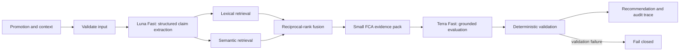
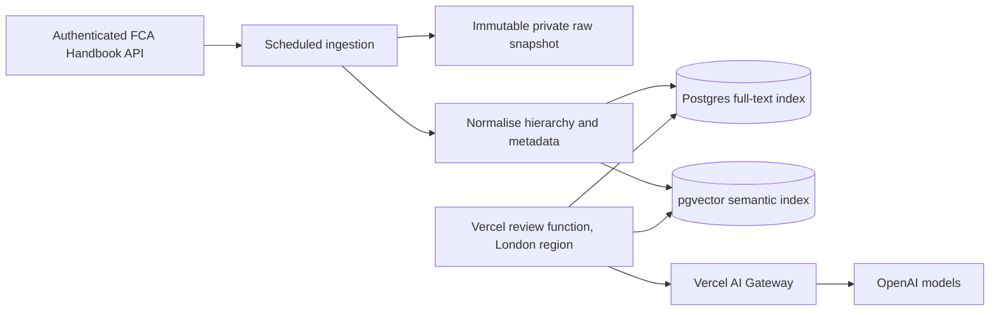

# Architecture

## Live review path

The browser receives newline-delimited stage events so it can show useful progress without waiting for the complete result. Regulatory quotations are never generated by the model: rule IDs are resolved to exact text stored in the versioned regulatory pack.

## Why two model calls

Extraction and regulatory evaluation have different jobs. Separating them makes the evidence boundary visible, lets retrieval use a compact structured query, and gives the validator inspectable intermediate results. A single large prompt would be faster to prototype but harder to test, audit and constrain.

The selected fast models keep both calls responsive. Document embeddings are cached in a warm function process, and the evidence pack is deliberately small to reduce evaluation tokens and latency.

## Why hybrid retrieval

Lexical search is strong for exact provision language, product terminology and mandatory phrases. Semantic search catches paraphrases such as “your return is assured” when the source rule is phrased in terms of fairness or misleading communications. Metadata/sourcebook boosts prevent semantic similarity from overriding product applicability. Reciprocal-rank fusion combines the two rankings without treating either score scale as authoritative.

## Full-Handbook production topology

The full Handbook does not belong in the frontend or Vercel function bundle. Keeping the lexical and vector indexes together simplifies filtering, versioning and transactional refreshes; co-locating the review function and database removes avoidable network latency. Raw snapshots remain immutable so historic reviews can be reproduced against the regulatory version used at the time.

The public work sample substitutes `lib/regulatory-pack.js` for this retrieval adapter until FCA API credentials and the necessary content permission are available. The adapter boundary, evidence-pack shape and validation path remain the same.

## Safety boundaries

- Every cited rule must have been retrieved from the configured snapshot or pack.
- Every regulatory quotation comes from stored source text.
- Every highlighted promotional phrase must be present in the submitted copy.
- The system does not claim that external substantiation exists or is absent when it has not been supplied.
- Text-only analysis never claims to verify visual prominence.
- The system recommends; the compliance reviewer decides.

