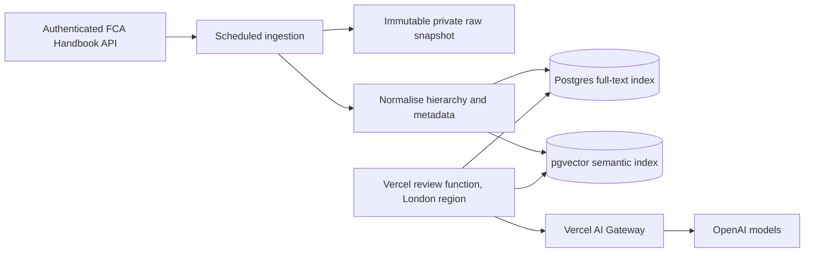

# Architecture

## Live review path

```mermaid
flowchart LR
    A[Promotion and ticket context] --> B{Validate context}
    B -- mismatch --> X[Withhold confident result]
    B -- consistent --> C[Applicability router]
    C --> D[Principal product lane]
    C --> E[Cross-cutting PRIN/GEN lanes]
    D --> F[Permitted candidate IDs]
    E --> F
    F --> G[Structured claim extraction]
    G --> H[Claim-level query plan]
    H --> I[Exact lexical regulatory hints]
    H --> J[Hybrid claim searches in same scope]
    I --> K[Citation-deduplicated merge]
    J --> K
    K --> L[Evidence pack, max 12 provisions]
    L --> M[Grounded evaluation]
    M --> N[Deterministic validation]
    N --> O[Recommendation and audit trace]
    N -- validation failure --> P[Fail closed]
```

The browser receives newline-delimited stage events so it can show useful progress without waiting for the complete result. Regulatory quotations are never generated by the model: rule IDs are resolved to exact text stored in the versioned regulatory pack.

## Why two model calls

Extraction and regulatory evaluation have different jobs. Separating them makes the evidence boundary visible, lets retrieval use a compact structured query, and gives the validator inspectable intermediate results. A single large prompt would be faster to prototype but harder to test, audit and constrain.

The evidence pack is deliberately bounded to reduce evaluation tokens and latency. The live smoke gate records extraction, retrieval, evaluation and total timing rather than assuming the selected models are sufficiently fast; current local end-to-end latency is still a measured optimization target.

## Applicability before retrieval

The product, channel, audience and jurisdiction already exist on the marketer's ticket. The router uses that context before search. Product selects one or more sourcebooks from the versioned FCA product registry; every route also includes targeted cross-cutting `PRIN` and `GEN` sections. Strong retrieved provisions can then expand a bounded set of same-snapshot outgoing references, including references into another sourcebook.

The router never falls back to searching the whole Handbook. Lexical and semantic retrieval receive the same permitted scope, and the scope definition is versioned in the audit record. See `docs/APPLICABILITY_ROUTER.md` for selectors, guardrails and measured corpus coverage.

## Why hybrid retrieval

Lexical search is strong for exact provision language, product terminology and mandatory phrases. Semantic search is retained to find conceptually related provisions and eventually improve paraphrase recall, but the first frozen evaluation shows that the current semantic query representation is broader and materially weaker than lexical retrieval for precise anchor citations. Hard applicability filtering—not a ranking boost—prevents either method from introducing an unrelated product sourcebook.

The corpus retriever uses lexical-anchored hybrid retrieval: preserve up to five unique strongest lexical citations, then fill the remaining evidence slots from reciprocal-rank fusion with a 2:1 lexical-to-semantic weight. Runtime review adds a query-planning layer because benchmark-supplied search concepts are not available to real users. Each extracted claim gets a hybrid query; structured claim type and applicable sourcebook add citation-free regulatory vocabulary; the governing-standard query remains lexical. High-precision results enter a citation-deduplicated 12-provision pack first, with query provenance retained in the trace. This legal-search-specific policy prevents exact regulatory matches from being buried while semantic search adds paraphrase coverage.

On the provisional version 2 retrieval benchmark, the underlying retriever fully covers 7 of 10 cases and 12 of 15 claim-level evidence groups, with zero route leakage. The separate live smoke gate passes 3 of 3 workflows and 6 of 6 provisional evidence groups using model-generated extraction. See `docs/RETRIEVAL_EVALUATION.md` and `docs/END_TO_END_SMOKE_TEST.md` for label authority, trace evidence, SME boundary and remaining work.

## Full-Handbook production topology

The full Handbook does not belong in the frontend. Keeping the lexical and vector indexes together simplifies filtering, versioning and transactional refreshes; co-locating the review function and database removes avoidable network latency. Raw snapshots remain immutable so historic reviews can be reproduced against the regulatory version used at the time.

The authenticated FCA API snapshot has been downloaded, normalized, structurally chunked, lexically indexed and fully embedded locally. `lib/full-corpus-retrieval.js` queries all 35,628 substantive chunks through the same applicability contract for lexical and semantic retrieval, validates evidence dynamically against exact stored provisions and performs bounded reference expansion. The completed embedding manifest records run `emb_6fe886733ffe1849834a`, `text-embedding-3-small`, 1,536 dimensions and both corpus checksums.

For the public demo, the same corpus is packaged as a 182.5 MB scalar-int8 SQLite derivative in 12 private Vercel Blob parts. A cold review function streams the parts into one temporary file, verifies the exact byte size and embedded snapshot manifest, and then caches it for the warm instance. Hosted execution forces full-corpus mode and fails closed rather than dropping to the eight-rule development fixture. The Blob approach keeps this work sample deployable; a managed lexical/vector database remains the production topology above for lower cold-start latency and concurrency.

## Embedding contract

The prototype will use the OpenAI Embeddings API for both the offline FCA chunk run and live promotion queries. It starts with `text-embedding-3-small` at its default 1,536 dimensions. `text-embedding-3-large` is considered only if the retrieval evaluation set shows a material quality gain worth its larger 3,072-dimension vectors and cost. These defaults are documented in OpenAI's [vector embeddings guide](https://developers.openai.com/api/docs/guides/embeddings).

Every embedding build must record the model, dimensions, input snapshot ID, normalized/chunk corpus checksum and a unique embedding-run ID. Query embeddings must use the same model and dimensions as the selected index. The full normalized and chunked corpus remains the canonical source; embeddings are rebuildable derived data.

The local vector representation is a Float32 BLOB per chunk inside the same SQLite database. That is compact and sufficient for routed prototype scopes; the runtime performs cosine ranking only over the already-permitted route. Production can move the identical metadata contract to Postgres/pgvector for ANN search, concurrency and managed refreshes without changing the evidence pack or audit trace.

## Safety boundaries

- Every cited rule must have been retrieved from the configured snapshot or pack.
- Every regulatory quotation comes from stored source text.
- Every highlighted promotional phrase must be present in the submitted copy.
- The system does not claim that external substantiation exists or is absent when it has not been supplied.
- Text-only analysis never claims to verify visual prominence.
- The system recommends; the compliance reviewer decides.

